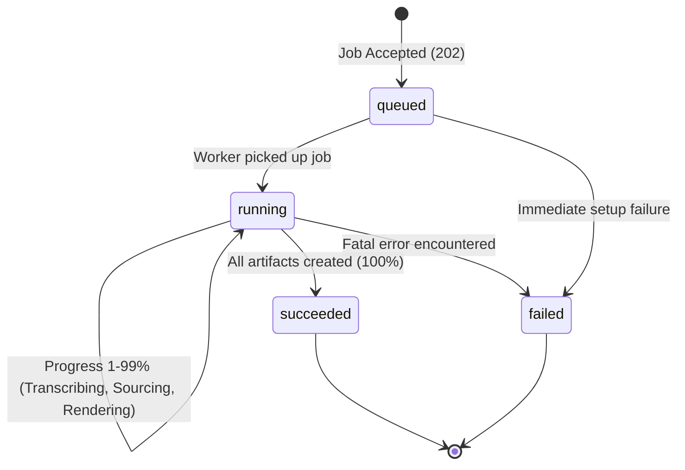

# IncuBrix Script-to-B-Roll Video Engine — API Contract

**Version:** 1.0.0-draft  
**Specification Standard:** OpenAPI 3.1 Compatible  
**Status:** Contract Design (Pre-implementation)  
**Target Delivery Window:** 3-day implementation  

---

## 1. Overview & Architecture Scope

This document specifies the input/output API contract for the **IncuBrix Script-to-B-roll Video Engine** (Assessment 3). The engine accepts a script, audio voiceover, or pre-segmented scenes and asynchronously produces finished, license-clean, multi-aspect-ratio B-roll videos with synchronized narration and captions.

### Scope Boundaries
- **In Scope:** HTTP endpoints, request/response JSON schemas, multipart upload definitions, header requirements, validation rules, state transition model, artifact specifications (`timeline.json`, `manifest.json`, `captions.srt`, `video_{ratio}.mp4`), and standard error catalogs.
- **Out of Scope (Deferred):** Agent harness implementation, LLM selection, footage provider credentials/integrations, rendering pipeline technology (FFmpeg/Remotion/GPU acceleration), and Docker setup.

---

## 2. Common HTTP Headers & Protocol Standards

All endpoints adhere to REST conventions under the `/api/v1/` prefix.

| Header | Type | Required | Description |
|---|---|---|---|
| `Content-Type` | string | Yes (POST) | `application/json` or `multipart/form-data` |
| `Idempotency-Key` | string (UUID v4 or client key, max 128 chars) | Yes (on `POST`) | Guarantees safe retries. Re-submitting the same key with identical payload returns the existing job without re-executing. Re-submitting with a conflicting payload returns `409 Conflict`. |
| `X-Correlation-Id` | string (UUID) | Recommended | Distributed tracing identifier. If omitted by the client, the server generates one and echoes it in responses and structured logs. |
| `X-IncuBrix-Signature` | string (hex) | In Webhook | HMAC-SHA256 signature generated over the webhook payload using a shared secret for delivery verification. |

---

## 3. Endpoints Summary

| Method | Path | Description | Expected Status |
|---|---|---|---|
| `POST` | `/api/v1/broll/jobs` | Submit a new video rendering job | `202 Accepted` |
| `GET` | `/api/v1/jobs/{job_id}` | Poll job status, progress, errors, or artifact links | `200 OK` |
| `GET` | `/api/v1/broll/jobs/{job_id}` | Alias for `/api/v1/jobs/{job_id}` | `200 OK` |
| `POST` | `/api/v1/broll/jobs/{job_id}/swap-clip` | Advanced: Replace a single scene's clip and trigger incremental re-render | `202 Accepted` |
| `GET` | `/health` | Liveness check (process running) | `200 OK` |
| `GET` | `/ready` | Readiness check (storage, worker, queue connected) | `200 OK` / `503 Service Unavailable` |

---

## 4. Job Submission: `POST /api/v1/broll/jobs`

Clients may submit jobs using either **`application/json`** (referencing an external `audio_url` or raw `script`/`scenes`) or **`multipart/form-data`** (uploading an audio file directly).

### 4.1 JSON Request Body Schema (`application/json`)

```json
{
  "script": "string | null",
  "audio_url": "string (uri) | null",
  "scenes": [
    {
      "text": "string (min 1 char)",
      "visual_hint": "string | null"
    }
  ],
  "voice": "string | null",
  "aspect_ratios": ["16:9", "9:16", "1:1"],
  "style": "string | null",
  "avoid": ["string"],
  "captions": {
    "burn_in": true,
    "srt": true
  },
  "callback_url": "string (uri) | null"
}
```

### 4.2 Multipart Request Schema (`multipart/form-data`)

When uploading narration directly:
- `audio_file`: Binary file (MP3, WAV, M4A; max 100MB, max duration 10 min).
- `config`: JSON string representing the remaining fields (`aspect_ratios`, `style`, `avoid`, `captions`, `callback_url`).

### 4.3 Field Definitions & Validation Rules

| Field | Type | Rules & Constraints |
|---|---|---|
| **Primary Input Mode** | `script` \| `audio_url` / `audio_file` \| `scenes` | **Strict XOR (Mutually Exclusive):** Exactly one of `script`, `audio_url`/`audio_file`, or `scenes` must be populated. If multiple or none are provided, reject with `422 INVALID_INPUT_MODE`. |
| `script` | `string` | UTF-8 plain text. Rejects empty string or whitespace-only (`EMPTY_SCRIPT`). Max length: 15,000 characters (~10 minutes of spoken narration). |
| `audio_url` | `string (uri)` | Must be a reachable HTTP/HTTPS URL returning audio MIME type `audio/mpeg`, `audio/wav`, `audio/x-wav`, `audio/mp4`, or `audio/x-m4a`. Duration must not exceed 600 seconds (10 minutes). Rejects inaccessible URL with `422 AUDIO_DOWNLOAD_FAILED` and files >10 min with `422 AUDIO_DURATION_EXCEEDED`. |
| `audio_file` | `binary` | Accepted containers: `.mp3`, `.wav`, `.m4a`. Max file size: 100 MB. Max duration: 600 seconds. Corrupted/unparseable files trigger `422 CORRUPT_AUDIO_FILE`. |
| `scenes` | `array[object]` | Custom IncuBrix scene list. Must contain 1 to 100 items. Each item must have `text` (non-empty string) and optional `visual_hint` (e.g., `"aerial view of financial district"`). |
| `voice` | `string` | Required when input mode is `script` or `scenes` without audio (default fallback: `"en-IN-female"` if omitted). Ignored when existing narration audio is provided. |
| `aspect_ratios` | `array[string]` | Non-empty array containing a unique subset of `["16:9", "9:16", "1:1"]`. Defaults to `["16:9"]`. Invalid entries trigger `422 UNSUPPORTED_ASPECT_RATIO`. |
| `style` | `string` | Optional aesthetic guidance (e.g., `"bright, modern, real-world footage"`). Default: `"modern, clean, authentic real-world"`. Max 300 chars. |
| `avoid` | `array[string]` | Optional list of negative visual constraints (e.g. `["people's faces", "alcohol", "weapons"]`). Max 20 items, max 100 chars per item. |
| `captions` | `object` | Defaults to `{"burn_in": true, "srt": true}`. `burn_in` controls hardcoded video subtitles; `srt` controls `.srt` file generation. |
| `callback_url` | `string (uri)` | Optional HTTPS webhook endpoint invoked upon job terminal completion (`succeeded` or `failed`). |

---

## 5. Job Creation Response: `HTTP 202 Accepted`

Returned immediately when the job passes schema validation and is queued for background processing.

### Response Headers
```http
HTTP/1.1 202 Accepted
Content-Type: application/json
Location: /api/v1/jobs/job_9b1deb4d-3b7d-4bad-9bdd-2b0d7b3dcb6d
X-Correlation-Id: c9b80b06-4b82-45e0-b964-b816deea0d1f
```

### Response Body
```json
{
  "job_id": "job_9b1deb4d-3b7d-4bad-9bdd-2b0d7b3dcb6d",
  "status": "queued",
  "progress": 0,
  "stage": "queued",
  "created_at": "2026-10-19T13:00:00Z",
  "urls": {
    "status_url": "/api/v1/jobs/job_9b1deb4d-3b7d-4bad-9bdd-2b0d7b3dcb6d",
    "cancel_url": "/api/v1/jobs/job_9b1deb4d-3b7d-4bad-9bdd-2b0d7b3dcb6d/cancel"
  }
}
```

---

## 6. Job Status & Results: `GET /api/v1/jobs/{job_id}`

### 6.1 State Machine



#### Progress Stages (`stage`)
1. `queued`: Waiting for available worker.
2. `transcribing`: Aligning audio or generating TTS speech.
3. `segmenting`: Decomposing speech into semantic scene boundaries.
4. `sourcing_footage`: Searching footage libraries, resolving licenses, evaluating relevance.
5. `normalizing`: Transcoding, scaling, and color/brightness matching clips.
6. `rendering`: Composing B-roll cuts, timing to voice, burning captions, exporting MP4s.
7. `packaging`: Writing `timeline.json`, `manifest.json`, and uploading to object store.
8. `completed`: All artifacts verified and available for download.

---

### 6.2 Running Status Response (`200 OK`)

```json
{
  "job_id": "job_9b1deb4d-3b7d-4bad-9bdd-2b0d7b3dcb6d",
  "status": "running",
  "progress": 45,
  "stage": "sourcing_footage",
  "created_at": "2026-10-19T13:00:00Z",
  "started_at": "2026-10-19T13:00:02Z",
  "estimated_remaining_seconds": 35,
  "error": null,
  "artifacts": null
}
```

---

### 6.3 Succeeded Status Response (`200 OK`)

When `status == "succeeded"`, `progress` is `100`, and the `artifacts` dictionary contains signed URLs or direct download links to the deliverables.

```json
{
  "job_id": "job_9b1deb4d-3b7d-4bad-9bdd-2b0d7b3dcb6d",
  "status": "succeeded",
  "progress": 100,
  "stage": "completed",
  "created_at": "2026-10-19T13:00:00Z",
  "started_at": "2026-10-19T13:00:02Z",
  "completed_at": "2026-10-19T13:00:48Z",
  "duration_seconds": 46.2,
  "error": null,
  "artifacts": {
    "videos": {
      "16:9": "https://storage.incubrix.internal/jobs/job_9b1deb4d/video_16_9.mp4",
      "9:16": "https://storage.incubrix.internal/jobs/job_9b1deb4d/video_9_16.mp4",
      "1:1": "https://storage.incubrix.internal/jobs/job_9b1deb4d/video_1_1.mp4"
    },
    "captions": "https://storage.incubrix.internal/jobs/job_9b1deb4d/captions.srt",
    "timeline": "https://storage.incubrix.internal/jobs/job_9b1deb4d/timeline.json",
    "manifest": "https://storage.incubrix.internal/jobs/job_9b1deb4d/manifest.json"
  }
}
```

> [!NOTE]
> **File naming convention on storage:** To guarantee filesystem and S3 URI compatibility, aspect ratios in filenames are formatted with underscores: `video_16_9.mp4`, `video_9_16.mp4`, and `video_1_1.mp4`.

---

### 6.4 Failed Status Response (`200 OK`)

When a job fails irrevocably, `status` becomes `failed`, and `error` contains standard troubleshooting metadata.

```json
{
  "job_id": "job_9b1deb4d-3b7d-4bad-9bdd-2b0d7b3dcb6d",
  "status": "failed",
  "progress": 62,
  "stage": "rendering",
  "created_at": "2026-10-19T13:00:00Z",
  "started_at": "2026-10-19T13:00:02Z",
  "failed_at": "2026-10-19T13:00:41Z",
  "error": {
    "code": "RENDER_PIPELINE_FAILED",
    "message": "FFmpeg process failed during 9:16 vertical crop filter execution.",
    "retryable": true,
    "details": {
      "exit_code": 1,
      "stage": "rendering_9_16",
      "hint": "Retry submission or verify video source frame integrity."
    }
  },
  "artifacts": null
}
```

---

## 7. Artifact Specifications & Schemas

### 7.1 Video Files (`video_{ratio}.mp4`)
- **Codec:** Video H.264 (High Profile, Level 4.1 or 4.2), Audio AAC (192 kbps, 48 kHz stereo).
- **Frame Rate:** Constant 30.0 fps (no variable frame rates).
- **Pixel Format:** `yuv420p`.
- **Target Resolutions:**
  - `16:9`: 1920x1080
  - `9:16`: 1080x1920 (smart-cropped / reframed with subject preserved)
  - `1:1`: 1080x1080
- **Audio:** Original or synthesized narration mixed over visuals with clean start and no audio drift.

---

### 7.2 Subtitles (`captions.srt`)
Standard SubRip Subtitle file format, UTF-8 encoded without BOM, timed to the exact syllable/word boundaries of the narration.

```text
1
00:00:00,000 --> 00:00:03,420
Saving money doesn't have to be complicated.

2
00:00:03,420 --> 00:00:07,150
It starts with understanding where every rupee goes.
```

---

### 7.3 `timeline.json` Schema & Specification

Per Assessment Must-Have #2, #3, and #5, `timeline.json` provides the complete scene-by-scene audit trail linking narration text to footage provenance, license safety, selection rationale, and relevance scoring.

```json
{
  "$schema": "https://json-schema.org/draft/2020-12/schema",
  "title": "IncuBrixTimeline",
  "type": "object",
  "required": ["job_id", "total_duration_ms", "scene_count", "scenes"],
  "properties": {
    "job_id": { "type": "string" },
    "total_duration_ms": { "type": "integer", "minimum": 0 },
    "scene_count": { "type": "integer", "minimum": 1 },
    "scenes": {
      "type": "array",
      "items": {
        "type": "object",
        "required": [
          "scene_index",
          "start_time_ms",
          "end_time_ms",
          "duration_ms",
          "narration_text",
          "clip",
          "selection_reason",
          "relevance_score"
        ],
        "properties": {
          "scene_index": { "type": "integer", "minimum": 0 },
          "start_time_ms": { "type": "integer", "minimum": 0 },
          "end_time_ms": { "type": "integer", "minimum": 0 },
          "duration_ms": { "type": "integer", "minimum": 0 },
          "narration_text": { "type": "string" },
          "visual_hint": { "type": ["string", "null"] },
          "clip": {
            "type": "object",
            "required": [
              "clip_id",
              "source_provider",
              "source_url",
              "license",
              "attribution",
              "is_ai_generated",
              "trim"
            ],
            "properties": {
              "clip_id": { "type": "string" },
              "source_provider": { "type": "string", "example": "pexels" },
              "source_url": { "type": "string", "format": "uri" },
              "license": {
                "type": "object",
                "required": ["type", "commercial_use_allowed", "attribution_required"],
                "properties": {
                  "type": { "type": "string", "example": "Pexels Free License" },
                  "commercial_use_allowed": { "type": "boolean" },
                  "attribution_required": { "type": "boolean" }
                }
              },
              "attribution": { "type": "string" },
              "is_ai_generated": { "type": "boolean" },
              "generator_model": { "type": ["string", "null"] },
              "trim": {
                "type": "object",
                "required": ["in_ms", "out_ms"],
                "properties": {
                  "in_ms": { "type": "integer" },
                  "out_ms": { "type": "integer" }
                }
              }
            }
          },
          "selection_reason": {
            "type": "string",
            "description": "Explains why footage was matched to semantic meaning rather than literal keyword."
          },
          "relevance_score": {
            "type": "number",
            "minimum": 1.0,
            "maximum": 5.0,
            "description": "Model or heuristic match score between text and chosen clip."
          }
        }
      }
    }
  }
}
```

#### Example `timeline.json`
```json
{
  "job_id": "job_9b1deb4d-3b7d-4bad-9bdd-2b0d7b3dcb6d",
  "total_duration_ms": 7150,
  "scene_count": 2,
  "scenes": [
    {
      "scene_index": 0,
      "start_time_ms": 0,
      "end_time_ms": 3420,
      "duration_ms": 3420,
      "narration_text": "Saving money doesn't have to be complicated.",
      "visual_hint": "person smiling while reviewing piggy bank or budget on laptop",
      "clip": {
        "clip_id": "px_8439102",
        "source_provider": "pexels",
        "source_url": "https://www.pexels.com/video/8439102/",
        "license": {
          "type": "Pexels License",
          "commercial_use_allowed": true,
          "attribution_required": false
        },
        "attribution": "Video by Karolina Grabowska from Pexels",
        "is_ai_generated": false,
        "generator_model": null,
        "trim": {
          "in_ms": 1200,
          "out_ms": 4620
        }
      },
      "selection_reason": "Matched semantic concept of accessible personal finance planning rather than literal cash pile.",
      "relevance_score": 4.6
    },
    {
      "scene_index": 1,
      "start_time_ms": 3420,
      "end_time_ms": 7150,
      "duration_ms": 3730,
      "narration_text": "It starts with understanding where every rupee goes.",
      "visual_hint": null,
      "clip": {
        "clip_id": "gen_88419b",
        "source_provider": "generative_engine",
        "source_url": "https://storage.incubrix.internal/generated/gen_88419b.mp4",
        "license": {
          "type": "Proprietary Commercial Output",
          "commercial_use_allowed": true,
          "attribution_required": false
        },
        "attribution": "Generated by IncuBrix Video Model",
        "is_ai_generated": true,
        "generator_model": "wan2.1-t2v-14b",
        "trim": {
          "in_ms": 0,
          "out_ms": 3730
        }
      },
      "selection_reason": "Stock provider returned no clean non-face clip for currency tracking; fallback generative rule triggered.",
      "relevance_score": 4.2
    }
  ]
}
```

---

### 7.4 `manifest.json` Schema & Specification

Per Integration Standard #9, every job output includes a machine-readable manifest recording models, providers, settings, random seeds, timings, granular cost breakdown, warnings, and full legal licensing rollup.

```json
{
  "$schema": "https://json-schema.org/draft/2020-12/schema",
  "title": "IncuBrixJobManifest",
  "type": "object",
  "required": [
    "manifest_version",
    "job_id",
    "timestamp",
    "models_and_providers",
    "settings",
    "timings_ms",
    "cost_breakdown",
    "warnings",
    "licensing_summary"
  ],
  "properties": {
    "manifest_version": { "type": "string", "example": "1.0.0" },
    "job_id": { "type": "string" },
    "timestamp": { "type": "string", "format": "date-time" },
    "models_and_providers": {
      "type": "object",
      "required": ["tts", "llm_segmenter", "stock_providers", "renderer"],
      "properties": {
        "tts": { "type": "string" },
        "llm_segmenter": { "type": "string" },
        "stock_providers": { "type": "array", "items": { "type": "string" } },
        "generative_video": { "type": ["string", "null"] },
        "relevance_vlm": { "type": ["string", "null"] },
        "renderer": { "type": "string" }
      }
    },
    "settings": {
      "type": "object",
      "required": ["input_mode", "aspect_ratios", "seed", "style", "avoid"],
      "properties": {
        "input_mode": { "type": "string", "enum": ["script", "audio", "scenes"] },
        "aspect_ratios": { "type": "array", "items": { "type": "string" } },
        "seed": { "type": "integer" },
        "style": { "type": "string" },
        "avoid": { "type": "array", "items": { "type": "string" } },
        "captions": { "type": "object" }
      }
    },
    "timings_ms": {
      "type": "object",
      "required": ["total", "transcription_or_tts", "segmentation", "footage_search", "normalization", "rendering"],
      "properties": {
        "total": { "type": "integer" },
        "transcription_or_tts": { "type": "integer" },
        "segmentation": { "type": "integer" },
        "footage_search": { "type": "integer" },
        "normalization": { "type": "integer" },
        "rendering": { "type": "integer" }
      }
    },
    "cost_breakdown": {
      "type": "object",
      "required": ["currency", "total_estimated_usd", "items"],
      "properties": {
        "currency": { "type": "string", "example": "USD" },
        "total_estimated_usd": { "type": "number" },
        "items": {
          "type": "array",
          "items": {
            "type": "object",
            "required": ["component", "provider", "units", "cost_usd"],
            "properties": {
              "component": { "type": "string" },
              "provider": { "type": "string" },
              "units": { "type": "string" },
              "cost_usd": { "type": "number" }
            }
          }
        }
      }
    },
    "warnings": {
      "type": "array",
      "items": {
        "type": "object",
        "required": ["code", "message", "scene_index"],
        "properties": {
          "code": { "type": "string" },
          "message": { "type": "string" },
          "scene_index": { "type": ["integer", "null"] }
        }
      }
    },
    "licensing_summary": {
      "type": "object",
      "required": ["all_commercial_use_cleared", "ai_generated_clips_count", "sources_used"],
      "properties": {
        "all_commercial_use_cleared": { "type": "boolean" },
        "ai_generated_clips_count": { "type": "integer" },
        "sources_used": { "type": "array", "items": { "type": "string" } }
      }
    }
  }
}
```

#### Example `manifest.json`
```json
{
  "manifest_version": "1.0.0",
  "job_id": "job_9b1deb4d-3b7d-4bad-9bdd-2b0d7b3dcb6d",
  "timestamp": "2026-10-19T13:00:48Z",
  "models_and_providers": {
    "tts": "kokoro-v1.0 (en-IN-female)",
    "llm_segmenter": "gemini-2.5-flash",
    "stock_providers": ["pexels-api-v1", "pixabay-api-v1"],
    "generative_video": "wan2.1-t2v-14b",
    "relevance_vlm": "clip-vit-base-patch32",
    "renderer": "ffmpeg-6.1-libx264"
  },
  "settings": {
    "input_mode": "script",
    "aspect_ratios": ["16:9", "9:16", "1:1"],
    "seed": 42091,
    "style": "bright, modern, real-world footage",
    "avoid": ["people's faces", "alcohol"],
    "captions": {
      "burn_in": true,
      "srt": true
    }
  },
  "timings_ms": {
    "total": 46200,
    "transcription_or_tts": 2100,
    "segmentation": 1400,
    "footage_search": 8300,
    "normalization": 6400,
    "rendering": 28000
  },
  "cost_breakdown": {
    "currency": "USD",
    "total_estimated_usd": 0.0142,
    "items": [
      {
        "component": "TTS",
        "provider": "Self-hosted Kokoro",
        "units": "14 words",
        "cost_usd": 0.0001
      },
      {
        "component": "LLM Segmentation",
        "provider": "Gemini 2.5 Flash",
        "units": "340 tokens",
        "cost_usd": 0.0001
      },
      {
        "component": "Stock Footage",
        "provider": "Pexels (Free Commercial)",
        "units": "1 clip",
        "cost_usd": 0.0000
      },
      {
        "component": "Generative Video",
        "provider": "Local GPU Worker",
        "units": "3.7s render",
        "cost_usd": 0.0120
      },
      {
        "component": "FFmpeg Compute",
        "provider": "CPU Worker",
        "units": "28s CPU time",
        "cost_usd": 0.0020
      }
    ]
  },
  "warnings": [
    {
      "code": "AVOID_FILTER_APPLIED",
      "message": "Filtered out 3 clips from Pexels due to detected human faces matching 'avoid' rule.",
      "scene_index": 0
    }
  ],
  "licensing_summary": {
    "all_commercial_use_cleared": true,
    "ai_generated_clips_count": 1,
    "sources_used": ["pexels", "generative_engine"]
  }
}
```

---

## 8. Clip Swap Endpoint (Advanced Level): `POST /api/v1/broll/jobs/{job_id}/swap-clip`

To satisfy the Advanced level requirement (*"Swap a clip: the user replaces one scene's clip and only the affected part is re-rendered in clearly less time than a full render"*), this endpoint creates a derived job that splices a single scene replacement into existing pre-rendered assets.

### Request Body
```json
{
  "scene_index": 1,
  "replacement_clip_url": "https://www.pexels.com/video/1234567/",
  "visual_hint": "alternate view of budget spreadsheet on phone",
  "selection_reason": "User manual override for scene 1."
}
```

### Response (`HTTP 202 Accepted`)
```json
{
  "job_id": "job_9b1deb4d-3b7d-4bad-9bdd-2b0d7b3dcb6d-swap-1",
  "parent_job_id": "job_9b1deb4d-3b7d-4bad-9bdd-2b0d7b3dcb6d",
  "status": "queued",
  "stage": "incremental_render",
  "progress": 0,
  "urls": {
    "status_url": "/api/v1/jobs/job_9b1deb4d-3b7d-4bad-9bdd-2b0d7b3dcb6d-swap-1"
  }
}
```

---

## 9. Error Handling & Standardized Error Envelope

Per Integration Standard #5:
- All errors return structured JSON with HTTP status code `>= 400`.
- Format: `{"error": {"code", "message", "retryable", "details"}}`.
- Codes are strictly formatted in `UPPER_SNAKE_CASE`.

### 9.1 Schema
```json
{
  "error": {
    "code": "UPPER_SNAKE_CASE_STRING",
    "message": "Human readable explanation of what went wrong and how to fix it.",
    "retryable": false,
    "details": {
      "field": "optional field name",
      "issue": "specific validation failure description",
      "constraint": "rule that was violated"
    }
  }
}
```

### 9.2 Error Code Catalog

| HTTP Status | Error Code (`code`) | Retryable | Description / Trigger Condition |
|---|---|---|---|
| `400 Bad Request` | `INVALID_JSON_BODY` | No | Malformed JSON request payload. |
| `400 Bad Request` | `MISSING_IDEMPOTENCY_KEY` | No | POST request sent without required `Idempotency-Key` header. |
| `404 Not Found` | `JOB_NOT_FOUND` | No | Specified `job_id` does not exist or has expired from cache. |
| `409 Conflict` | `IDEMPOTENCY_KEY_CONFLICT` | No | Reusing the same `Idempotency-Key` with a different payload or parameters. |
| `422 Unprocessable` | `INVALID_INPUT_MODE` | No | Request violates the XOR requirement: provided more than one or zero of `script`, `audio_url`/`audio_file`, or `scenes`. |
| `422 Unprocessable` | `EMPTY_SCRIPT` | No | `script` or `scenes[].text` is empty string or only whitespace. |
| `422 Unprocessable` | `SCRIPT_TOO_LONG` | No | `script` exceeds 15,000 characters. |
| `422 Unprocessable` | `UNSUPPORTED_ASPECT_RATIO` | No | Provided ratio not in `["16:9", "9:16", "1:1"]`. |
| `422 Unprocessable` | `UNSUPPORTED_AUDIO_FORMAT` | No | Audio mime-type/extension is not MP3, WAV, or M4A. |
| `422 Unprocessable` | `AUDIO_DURATION_EXCEEDED` | No | Audio duration exceeds 600 seconds (10 minutes). |
| `422 Unprocessable` | `AUDIO_DOWNLOAD_FAILED` | Yes | HTTP error, timeout, or DNS resolution failure while fetching `audio_url`. |
| `422 Unprocessable` | `CORRUPT_AUDIO_FILE` | No | Audio stream header invalid, silent, or unparseable. |
| `422 Unprocessable` | `INVALID_SCENE_SEQUENCE` | No | `scenes` list is empty, exceeds 100 scenes, or lacks required text. |
| `429 Too Many Requests`| `RATE_LIMIT_EXCEEDED` | Yes | Request rate or active concurrency limit exceeded. Check `Retry-After` header. |
| `500 Server Error` | `TTS_GENERATION_FAILED` | Yes | Text-to-speech engine failed to synthesize audio stream. |
| `500 Server Error` | `FOOTAGE_SOURCE_EXHAUSTED` | Yes | All primary and fallback footage providers failed to return usable clips. |
| `500 Server Error` | `RENDER_PIPELINE_FAILED` | Yes | FFmpeg or compositor encountered an unrecoverable rendering crash. |
| `500 Server Error` | `INTERNAL_SERVER_ERROR` | Yes | Unexpected internal failure. Check structured logs with `X-Correlation-Id`. |
| `503 Service Unavailable`| `SERVICE_UNREADY` | Yes | Returned by `GET /ready` when dependent databases, workers, or storage are unreachable. |

---

## 10. Webhook Notification Contract

If `callback_url` is provided, the engine sends an HTTP POST upon reaching a terminal state (`succeeded` or `failed`).

### Request Headers
```http
POST /your-webhook-endpoint HTTP/1.1
Host: your-server.com
Content-Type: application/json
X-IncuBrix-Signature: sha256=d58d9...
X-Correlation-Id: c9b80b06-4b82-45e0-b964-b816deea0d1f
```

### Signature Verification Algorithm
```python
expected_signature = "sha256=" + hmac.new(
    key=SHARED_WEBHOOK_SECRET.encode("utf-8"),
    msg=raw_request_body_bytes,
    digestmod=hashlib.sha256
).hexdigest()
```

### Webhook Payload
The webhook payload matches the `GET /api/v1/jobs/{job_id}` response body exactly (Section 6.3 or 6.4).

---

## 11. Decisions Flagged for Confirmation

The following design decisions are documented for confirmation before implementation begins:

1. **Job Status Route Path:**
   - *Decision:* Provide `GET /api/v1/jobs/{job_id}` (as specified in Integration Standard #3) and alias `GET /api/v1/broll/jobs/{job_id}` (consistent with REST resource hierarchy).
   - *Confirmation:* Confirm if clients strictly require `/api/v1/jobs/{job_id}` or if both must be routed.

2. **Aspect Ratio Filename Representation:**
   - *Decision:* Aspect ratio colons (e.g. `16:9`) are replaced with underscores in stored artifact filenames (`video_16_9.mp4`) to avoid filesystem and URL escaping issues on S3/MinIO and Windows/Linux.
   - *Confirmation:* Confirm if downstream test harness expects `video_16_9.mp4` or literal `video_16:9.mp4`.

3. **Storage Retention & Presigned URLs:**
   - *Decision:* Artifact download links are generated as direct download URLs against MinIO/S3 with a default 24-hour expiration token if private, or persistent public bucket URLs in local development.
   - *Confirmation:* Confirm if local mock storage requires unauthenticated access for automated grading.

4. **Swap-Clip Endpoint Inclusion:**
   - *Decision:* Defined `POST /api/v1/broll/jobs/{job_id}/swap-clip` as an optional extension to support the Advanced Level requirement without complicating the Core 3-day path.
