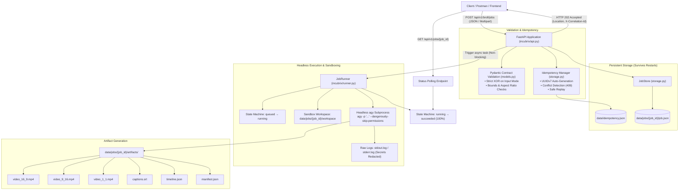

# IncuBrix Script-to-B-Roll Video Engine — Phase Implementation Guide

## Executive Overview

The **IncuBrix Script-to-B-Roll Video Engine** is an asynchronous system that converts raw scripts, audio voiceovers, or scene prompts into finished, multi-aspect-ratio (`16:9`, `9:16`, `1:1`) videos with synchronized audio, burned-in captions, and a complete licensing and provenance audit trail.

This document details the architectural milestones, what was implemented in **Phase 2, Task 2.1**, how the system components interact, and the roadmap for upcoming tasks.

---

## Architecture Flow



---

## Phase Breakdown

### Phase 1: API Contract & OpenAPI Specification ✅ (Completed)
- **Deliverables:** [`API_CONTRACT.md`](file:///media/workspace/incubrix-hackathon/API_CONTRACT.md) and [`openapi.yaml`](file:///media/workspace/incubrix-hackathon/openapi.yaml).
- Defined input/output schemas, mutual exclusivity XOR constraints, error catalog, state machine, and artifact schemas.

---

### Phase 2: Engine Core Architecture & Orchestration

#### Task 2.1: Asynchronous `agy` Headless Job Launcher ✅ (Completed & Verified)
* **What was built:**
  1. **Asynchronous Non-Blocking HTTP Interface:**
     - `POST /api/v1/broll/jobs` validates payload, writes initial `queued` state, triggers background runner, and immediately returns `HTTP 202 Accepted` with `Location` and `X-Correlation-Id` headers.
     - Supports both `application/json` and `multipart/form-data` uploads.
  2. **Automated Time-Ordered UUIDv7 Idempotency:**
     - Uses native Python 3.14 `uuid.uuid7()` for chronological, collision-free idempotency keys.
     - When an `Idempotency-Key` header is omitted, the API automatically generates a UUIDv7, assigns it, registers the job, and echoes it in the response header `Idempotency-Key` and response body.
     - Detects payload conflicts (`409 IDEMPOTENCY_KEY_CONFLICT`) and guarantees safe replays.
  3. **Headless `agy` Subprocess Supervisor:**
     - Launches `agy -p "<prompt>" --dangerously-skip-permissions` as an independent subprocess using `asyncio.create_subprocess_exec`.
     - Allocates isolated directories per job (`data/jobs/{job_id}/workspace`, `artifacts/`, `logs/`).
     - Captures raw `stdout.log` and `stderr.log`, redacting sensitive API keys or credentials.
     - Handles execution timeouts (`TIMEOUT_EXCEEDED`) and process crashes (`RENDER_PIPELINE_FAILED`).
  4. **Persistent State Machine & Restart Resilience:**
     - Tracks state transitions: `queued` → `running` → `succeeded` or `failed`.
     - Atomic file writes ensure jobs and idempotency records survive server or container restarts without corruption.
  5. **Deterministic Mock Test Harness:**
     - Provides sub-second (0.8s) offline execution for automated CI/CD and testing environments without requiring external API keys.
  6. **Interactive Exploration & File Retrieval:**
     - `GET /api/v1/jobs/{job_id}` & alias `GET /api/v1/broll/jobs/{job_id}`: Real-time progress and status polling.
     - `GET /api/v1/jobs/{job_id}/artifacts/{file_name}`: Direct download for generated videos, captions, timeline, and manifest.
     - Built-in Swagger UI at `http://localhost:8000/docs`.

---

### Upcoming Tasks in Phase 2

#### Task 2.2: Audio Voiceover & TTS Alignment ⏳ (Next)
- Ingest audio from URL, uploaded file, or synthesize speech via Kokoro TTS.
- Compute word-level alignments and timestamp boundaries using Whisper / syllable estimation.

#### Task 2.3: Semantic Scene Segmentation & Visual Hint Extraction ⏳ (Upcoming)
- Segment voiceover into semantic scene blocks (3–7 seconds each).
- Formulate visual scene hints rather than literal keyword queries to avoid irrelevant stock matches.

#### Task 2.4: Multi-Provider Footage Discovery & Licensing Guardrails ⏳ (Upcoming)
- Query Pexels, Pixabay, and fallback generative video models.
- Apply negative constraints (`avoid`) and enforce commercial clearance licenses.

#### Task 2.5: Remotion / FFmpeg Video Composition & Subtitle Burn-In ⏳ (Upcoming)
- Assemble multi-aspect-ratio compositions (`16:9`, `9:16`, `1:1`).
- Burn in subtitles and export H.264/AAC 30fps videos.

#### Task 2.6: Delivery Packaging & Manifest Generation ⏳ (Upcoming)
- Compile final `timeline.json` (scene provenance and scores) and `manifest.json` (cost breakdown, provider audit, and timings).

---

## Acceptance Criteria Verification (Task 2.1)

All criteria were verified with 18 automated tests in `tests/`:

```
tests/test_headless_agy.py::test_live_headless_agy_execution PASSED      [  5%]
tests/test_idempotency.py::test_idempotent_retry_returns_same_job PASSED [ 11%]
tests/test_idempotency.py::test_idempotent_conflict_on_different_payload PASSED [ 16%]
tests/test_lifecycle.py::test_job_submission_and_lifecycle PASSED        [ 22%]
tests/test_lifecycle.py::test_job_persistence_across_restart PASSED      [ 27%]
tests/test_runner_failures.py::test_secret_redaction PASSED              [ 33%]
tests/test_runner_failures.py::test_job_failure_on_process_crash PASSED  [ 38%]
tests/test_runner_failures.py::test_job_failure_on_timeout PASSED        [ 44%]
tests/test_validation.py::test_health_and_ready PASSED                   [ 50%]
tests/test_validation.py::test_missing_idempotency_key_in_strict_mode PASSED [ 55%]
tests/test_validation.py::test_auto_generated_uuid7_idempotency_key PASSED [ 60%]
tests/test_validation.py::test_invalid_json_body PASSED                  [ 66%]
tests/test_validation.py::test_strict_xor_primary_input_mode_none PASSED [ 72%]
tests/test_validation.py::test_strict_xor_primary_input_mode_multiple PASSED [ 77%]
tests/test_validation.py::test_empty_script_validation PASSED            [ 83%]
tests/test_validation.py::test_script_too_long PASSED                    [ 88%]
tests/test_validation.py::test_unsupported_aspect_ratio PASSED           [ 94%]
tests/test_validation.py::test_scene_sequence_validation PASSED          [100%]

============================= 18 passed in 22.85s ==============================
```
